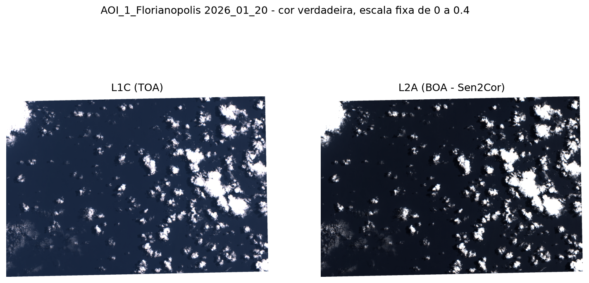
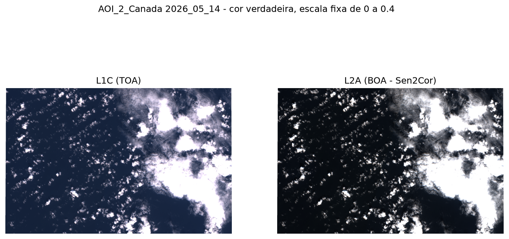
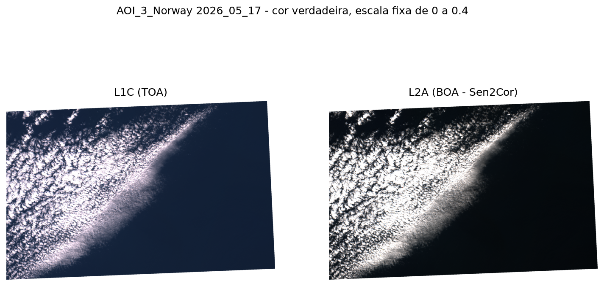
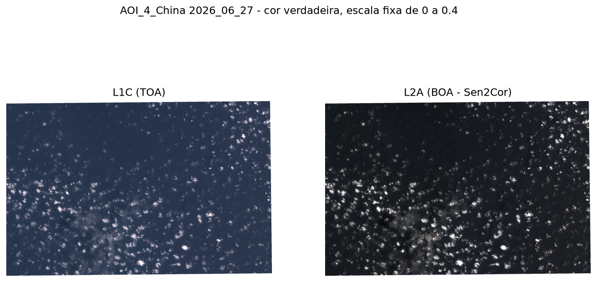

# M2 - Implementação parcial e análise técnica

Projeto: Correção atmosférica (AC) de imagens de sensoriamento remoto para áreas de oceano aberto

Integrantes: Erick Lemos Barreto, Janine de Paula, Melissa Moreira de Oliveira

Link para apresentação M2: https://youtu.be/hud27jPzctY

---

## 1. Síntese do Problema

A nossa proposta aborda o problema da correção atmosférica (AC) em imagens de sensoriamento remoto, com foco específico em ambientes de oceano aberto. As imagens capturadas pelo sensor no Topo da Atmosfera (TOA, Nível L1C) agregam tanto a resposta radiométrica da superfície quanto os efeitos de espalhamento e absorção causados por gases e aerossóis. Em ecossistemas oceânicos abertos, essa distorção atmosférica se mostra particularmente severa, visto que aproximadamente 90% da radiância total registrada pelo sensor vem da atmosfera, o que compromete a confiabilidade de análises voltadas à cor da água. O objetivo central do projeto consiste no desenvolvimento e na avaliação de um pipeline computacional de processamento digital de imagens (PDI) para estimar a reflectância da água na Base da Atmosfera (BOA), a partir da aplicação de técnicas clássicas como o modelo de correção baseado na premissa do pixel escuro (black-pixel assumption, Gordon e Wang, 1994) com o auxílio de bandas do infravermelho próximo (NIR) e de ondas curtas (SWIR), além da correção do espalhamento de Rayleigh orientada por parâmetros de geometria solar e de visada. Metodologicamente, o estudo utiliza um conjunto de dados composto por cenas do satélite Sentinel-2 MSI obtidas por meio do Copernicus Data Space Ecosystem, estruturado em Áreas de Interesse (AOIs) representativas.

## 2. Objetivo atual

Na etapa M2, o enfoque recai sobre segmentação, morfologia e descrição de regiões. Nesse sentido, foi implementada a segmentação dos pixels de água, pré-requisito do método black-pixel, que opera sobre áreas livres de nuvens. A segmentação combina limiarização nas bandas B11 e B10, abertura morfológica, rotulagem de componentes conexos, detecção de terra por índice espectral (NDWI) e margem de segurança ao redor dos objetos excluídos. A correção de Rayleigh, o método black-pixel e a comparação com o L2A permanecem como etapas pendentes, previstas para a M3.

## 3. Resposta ao feedback 

3.1 Um dos pontos reclamados no feedbakc passado foi a questão do controle de dados, agora temos somente GeoTIFFs no nosso dataset, sem vários metadados separados e CSVs.
3.1 Outro ponto foi a definição de especificações matemáticas sobre as máscaras, que foi desenvolvido no mascara.py e apresentou resultados satisfatórios.
3.3 Também desenvolvemos/adicionamos dados e scripts (módulos).

Sobre os direcionamentos do feedback que foram: 
1. Fixar uma região oceânica, uma pequena série de datas e bandas necessárias. (fizemos)
2. Definir precisamente L1C, produto de referência e alinhamento/resolução antes da comparação pixel a pixel. (fizemos)
3. Implementar controle de qualidade que rejeite cenas inválidas e pixels com nuvem/terra. (fizemos, no caso é as cenas com menos de 5% de pixels válidos de água que não são corrigidas) 
4. Comparar uma implementação mínima com produto oficial ou ferramenta consolidada, registrando erro por banda. (ainda em desenvolvimento, atualmente comparação só visual)
5. Não transformar as aplicações futuras — óleo, plástico, algas — em novos objetivos; elas são apenas motivação. (Essas questões específicas estão fora do escop sim)

## 4. Evolução desde a M1
Sobre isso fizemos adição do dataset com 4 AOIs, de 3 datas diferentes e de níveis L1C e L2A, adicionamos também os módulos em src o que iniciou o implementação do projeto de fato. 

**4.1** Nosso módulo de leitura: [leitura.py](https://github.com/ErickLemosB/AC_Open_Ocean/tree/main/src/leitura.py). Esse módulo vai carregar as cenas baixadas do Copernicus que ficam em [images/input](https://github.com/ErickLemosB/AC_Open_Ocean/tree/main/images/input), percorrendo as pastas das nossas AOIs e montando os pares L1C/L2A de cada data escolhida.

 

Essa função abre nossos GeoTIFF e devolve duas camadas: a reflectância da banda e a máscara de dados válidos vulgo datamask.


Já essa função vai ler as bandas de uma cena e vai guardar elas em um dicionário indexado por seus nomes (B01,B02...). A máscara de dados válidos final é a intersecção das máscaras de todas as bandas. (ou seja, um pixel só vai ser válido se existir dado em todas elas.)

Nos testes desse módulo confirmamos que os pares tem as mesmas dimensões e datamask, o que torna nossa comparação pixel a pixel viável. Para visualizar os testes acesse [Test_1](https://github.com/ErickLemosB/AC_Open_Ocean/tree/main/Tests_Outputs/Test_1.md) e [Test_2](https://github.com/ErickLemosB/AC_Open_Ocean/tree/main/Tests_Outputs/Test_2.md)

**4.2** Nosso módulo que monta as figuras de cor verdadeira das cenas: [figuras.py](https://github.com/ErickLemosB/AC_Open_Ocean/tree/main/src/figuras.py). Esse módulo gera as imagens em true color para inspeção visual.


Essa função vai empilhar as bandas no canal RGB (respectivamente B04, B03 e B02) e depois vai dividir a reflectância por um valor fixo de 0,4 e limita o valor entre o intervalo [0,1]

Sobre a escala de 0,4: ela equivale ao ganho de x2.5 usado no Copernicus.
Sobre o datamask, ele é usado como canal de transparência. Desse jeito, as regiões sem dados não aparecem como pixel escuro, que poderia ser confundido com água.

Ao executar o módulo, obtemos uma figura para cada cena, comparando L1C com L2A lado a lado. Podemos visualizar a saída aqui [true_color_outputs](https://github.com/ErickLemosB/AC_Open_Ocean/tree/main/images/results/true_color_outputs) e o teste aqui [Test_3](https://github.com/ErickLemosB/AC_Open_Ocean/tree/main/Tests_Outputs/Test_3.md).

**4.3** Nosso módulo que faz as máscaras, até agora o mais complexo e importante ainda tem algumas coisas que vamos mudar/implmentar, mas por enquanto o resultado é satisfatório. [mascara.py](https://github.com/ErickLemosB/AC_Open_Ocean/tree/main/src/mascara.py)


Esse modo basicamente classifica cada pixel do L1C em nuvem, terra, margem ou água válida. Pois só a água válida vai ser usada na correção atmosférica.

Aqui fazemos segmentação por limiar; abertura morfológica (erosão seguida de dilatação, com disco de raio = 1 pixel; Detecção de terra com o NDWI; Margem de segurança (em volta da nuvem); componentes conexos; e por fim um critério de aceite, somente cenas com mais de 5% de água válida vão ser corrigidas.


## 5. Dados utilizados
 
Foi utilizado uma base pública de dados que fornece imagens de satélite Sentinel-2 MSI, nível L1C (TOA) e nível L2A (BOA):https://browser.dataspace.copernicus.eu/

ou também por sua respectiva API.

Através do site da Copernicus, conseguimos montar nosso Dataset de 4 áreas de interesse distintas.

## 6. Protocolo experimental
 
| Teste | Dados | Procedimento | Critério de verificação |
| --- | --- | --- | --- |
| **1** (`leitura.py`) | Um par: Florianópolis, 2026_06_16 | Impressão do formato da imagem, da % de pixels com dado e do mínimo e do máximo de cada banda em L1C e L2A | Conferência visual dos valores. A ausência de B10 no L2A é esperada. |
| **2** (`leitura.py`) | Os 12 pares | Comparação do número de bandas, do formato da imagem e da % com dado, e verificação da igualdade da máscara de dados entre L1C e L2A (`np.array_equal`) | Resposta "sim" ou "não" por par. Concluiu-se que os pares são consistentes. |
| **3** (`figuras.py`) | Os 12 pares | Geração da imagem em cor verdadeira (B04, B03 e B02 divididas por 0,4 e limitadas a 0–1), com L1C e L2A lado a lado, salva em `images/results/true_color_outputs/` | Comparação visual com a cor verdadeira do site do Copernicus. |
| **4** (`mascara.py`) | Uma cena: Florianópolis, 2026_06_16, apenas L1C | Cálculo das máscaras de nuvem, terra, margem e água com abertura de raio 0 e de raio 1. Impressão da % por classe, do número de nuvens, da área total, da maior nuvem e da suficiência de água. Geração do mapa de classes. | Inspeção visual do mapa em relação à imagem. O grupo registrou que "condiz bem com a realidade". |
 
## 6.1. Parâmetros do Teste 4 (`mascara.py`)
 
| Parâmetro | Valor |
| --- | --- |
| `LIMIAR_B11` | 0,02 |
| `LIMIAR_B10` | 0,005 |
| `RAIO_ABERTURA` | 1 (comparado com 0) |
| `RAIO_MARGEM` | 5 px (100 m) |
| `MIN_FRACAO_AGUA` | 5% |
| `AREA_PIXEL_KM2` | 0,0004 km² |


 ## 7. Pipeline e Organização

O pipeline planejado compreende aquisição, pré-processamento, correção atmosférica, avaliação e visualização. Na M2, foram implementadas a leitura dos dados, a visualização em cor verdadeira e o pré-processamento, entendido como a segmentação dos pixels de água.

Fluxo implementado:
 
```
listar_cenas → ler_cena → calcular_mascara → descrever_nuvens
                              (nuvem → abertura → terra → margem → água)
```
 
## 7.1. Etapas implementadas
 
| Etapa | Função (arquivo) | Entrada | Saída | Parâmetros |
| --- | --- | --- | --- | --- |
| Descoberta de cenas | `listar_cenas`| `images/input/` | pares L1C/L2A por AOI e data | padrão de nome `AOI_*/*_L1C_*` |
| Leitura de bandas | `ler_banda`, `ler_cena` | pasta da cena (um `.tiff` por banda) | dicionário banda → reflectância; máscara de dados válidos | — |
| Cor verdadeira | `cor_verdadeira` | B04, B03, B02 e máscara de dados | imagem RGBA | escala fixa 0–0,4 |
| Detecção de nuvens | `mascara_nuvens` | B11, B10 | máscara booleana de nuvem | B11 > 0,02 ou B10 > 0,005 |
| Abertura morfológica | `abertura`, `disco` | máscara de nuvem | máscara sem detecções menores que o elemento estruturante | disco de raio 1 |
| Detecção de terra | `mascara_terra` | B03, B08, nuvem | máscara de terra | NDWI < 0, fora de nuvem |
| Margem de segurança | `mascara_margem` | nuvem, terra | anel ao redor de nuvem e terra | dilatação de 5 px (100 m) |
| Descrição de regiões | `descrever_nuvens` | máscara de nuvem | número de nuvens, área total e maior área (km²) | vizinhança-8; 0,0004 km²/pixel |
| Água utilizável | `calcular_mascara`, `agua_suficiente`| bandas e máscara de dados | máscara de água (com dado, sem nuvem, terra ou margem); decisão de corrigir a cena | mínimo de 5% de água |
 
 
## 7.2. Etapas pendentes

7.2.1 Geometria, consultar o catálogo de dados STAC de cada cena e pegar os ângulos que precisamos para fazer o cálculos geométricos.
7.2.2 Correção atmosférica de fato.
7.2.3 Avaliar os resultados contra L2A por exemplo.
7.2.4 Figuras e gráficos apresentando e comparando os resultados obtidos com os esperados.

 
## 8. Testes

| Teste | Objetivo | Resultado registrado |
|---|---|---|
| Teste 1 — leitura | Inspecionar um par de cenas e os valores das bandas | Leitura bem-sucedida; B10 ausente em L2A é esperado |
| Teste 2 — pares | Comparar shape e máscara de dados L1C/L2A | Dimensões e máscaras compatíveis nos pares testados |
| Teste 3 — RGB | Produzir cor verdadeira e comparar visualmente com o navegador Copernicus | Foram produzidas imagens RGB para as cenas |
| Teste 4 — máscara | Avaliar máscara de nuvens/terra/margem/água | Resultado visual considerado satisfatório |

### 8.1 Figuras de cor verdadeira

A seguir estão exemplos versionados do conjunto. A composição usa bandas B04, B03 e B02 e escala de exibição fixa. Estas figuras documentam cobertura e aparência visual, **não** resultados de correção atmosférica.



*Figura 1 - Composição em cor verdadeira da AOI de Florianópolis em 20/01/2026. A imagem permite inspecionar a aparência geral da cena, mas não quantifica a reflectância da água nem demonstra remoção do caminho atmosférico.*



*Figura 2 - Composição em cor verdadeira da AOI do Canadá em 14/05/2026. A mesma escala de visualização facilita comparação visual entre cenas; diferenças de brilho podem decorrer tanto da cena quanto das condições de aquisição e da transformação de exibição.*



*Figura 3 - Composição em cor verdadeira da AOI da Noruega em 17/05/2026. A figura serve como inspeção qualitativa e não permite, isoladamente, atribuir diferenças visuais a aerossóis ou estimar a qualidade da correção.*



*Figura 4 - Composição em cor verdadeira da AOI da China em 27/06/2026. A presença de quatro áreas geográficas amplia a diversidade de cenas, mas três datas por área ainda são uma amostra limitada para generalização.*

## 9. Falhas, limitações e riscos;

9.1 Limiar de nuvem é fixo: não se adapta a cena mais clara ou escura
9.2 Cirrus muito fino pode escapar do limiar de B10
9.3 Margem de 5 px pode estar grande demais e descartar água boa (ajuste para 4 px está em avaliação)
9.4 Ainda não validamos a máscara contra nenhuma referência

## 10. Plano de conclusão para a M3

Para a M3 planejamos iniciar de imediato o estudo e implementação dos cálculos geométricos e logo em seguida iniciar o mesmo para a AC. Após rodar uma série de testes, vamos montar nossa metodologia de avaliação, para enfim, com os dados de saída dela fazer o output das comparações.

## 11. Contribuições dos integrantes 

Sobre a participação dos integrantes, o projeto foi feito durante várias micro calls, onde eu abria a tela e mostrava o que tínhamos e juntos tomamos decisões para desenvolvimento e implementação do projeto, a parte de código/commits ficou mais com Erick Lemos Barreto. Decisões, estudos e ajuda na implementação Melissa Moreira de Oliveira e Janine de Paula. Sobre a confecção dos slides e boa parte do relatório, também, Melissa Moreira de Oliveira e Janine de Paula.

## 12. Referências 

https://rasterio.readthedocs.io/en/stable/ 

https://numpy.org/doc/stable/

https://docs.python.org/3/library/pathlib.html 

https://documentation.dataspace.copernicus.eu/Applications/Browser.html 

https://custom-scripts.sentinel-hub.com/sentinel-2/true_color/

https://matplotlib.org/stable/

https://docs.scipy.org/doc/scipy/reference/ndimage.html

GONZALEZ, R. C.; WOODS, R. E. Processamento digital de imagens. 3. ed. Pearson, 2010. cap. 10: segmentação por limiar; cap. 9: erosão, dilatação, abertura, elemento estruturante e componentes conexos com vizinhança-8.

McFEETERS, S. K. The use of the Normalized Difference Water Index (NDWI) in the delineation of open water features. International Journal of Remote Sensing, 17(7), 1425–1432, 1996.

ESA, Sentinel-2 User Handbook: B10 (1375 nm) é a banda de cirrus e B11 (1610 nm) é SWIR.

GORDON, H. R.; WANG, M. Retrieval of water-leaving radiance and aerosol optical thickness over the oceans with SeaWiFS: a preliminary algorithm. Applied Optics, 33(3), 443–452, 1994


## 13. Declaração de uso de IA.
 1. Tipo usado: Claude code
 
 2. Para quais fins?: 
 
  2.1 Commit automático do Dataset (montado manualmente).
  
  2.2 Gerar material de estudo para melhor entendimento dos assuntos abordados.
  
  2.3 Gerar exemplos de código para melhor entendimento do desenvolvimento.
  
  2.4 Auxílio no desenvolvimento do código para eventuais dúvidas durante o processo.
  
  2.5 Gerar o molde base do código nos padrões solicitados.

(Nota: Ouve uso do copilot para automatizar a descricao de alguns commits pela praticidade)
